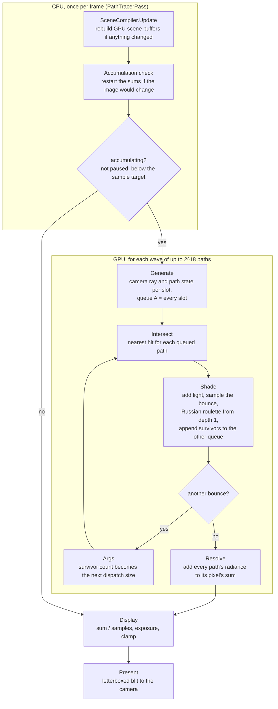

# Runtime control flow

`PathTracerPass` records one frame into URP's render graph. The CPU only decides what runs. Every stage below is a
compute kernel on the GPU, and each kernel runs one thread per path (or per pixel).

| Stage | Threads | Reads | Writes |
|---|---|---|---|
| Generate | one per slot in the wave | camera, sampler | rays, path state, queue A, counters, dispatch args |
| Intersect | one per queued path (indirect) | rays, queue, scene objects | hits |
| Shade | one per queued path (indirect) | hits, rays, path state, scene, materials | path state, rays, the other queue |
| Args | one | counters | dispatch args, counters |
| Resolve | one per slot in the wave | path state | accumulation sums |
| Display | one per pixel | accumulation sums | display texture |
| Present | raster blit | display texture | camera target |

## How the parallel parts fit

- **Waves.** Path memory is sized for $2^{18}$ slots, not for the image. A frame runs as many waves as it needs to give every
  pixel one sample (two at Edit Mode's 960 by 540).
- **Queues.** Paths die at different bounces (escaping, or stopped by Russian roulette). Shade appends the survivors to a fresh queue with an atomic add, so the next
  Intersect and Shade only launch threads for live paths. Two queues swap roles every bounce so no kernel reads and appends
  the same list.
- **Indirect dispatch.** The survivor count only exists on the GPU. The one-thread Args kernel turns it into the next
  dispatch size, so the CPU never waits for the GPU between bounces.
- **Accumulation.** Resolve adds each sample to a per-pixel sum, and Display divides by the sample count. Anything that
  changes the image (camera, scene, bounces, AOV) restarts the sums; exposure doesn't, because it applies after averaging.

The checkpoint devlogs in `Docs/Checkpoints` explain why each piece is built this way.
