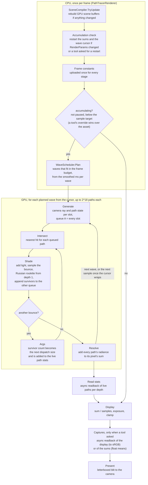

# Runtime control flow

`PathTracerRenderer` records one frame into a render graph, and `PathTracerPass` is the thin URP adapter that calls it
and presents the result. The CPU only decides what runs. Every stage below is a compute kernel on the GPU, and each kernel
runs one thread per path (or per pixel).

| Stage | Threads | Reads | Writes |
|---|---|---|---|
| Generate | one per slot in the wave | frame constants | rays, path state, queue A, counters, dispatch args |
| Intersect | one per queued path (indirect) | rays, queue, scene objects | hits |
| Shade | one per queued path (indirect) | hits, rays, path state, scene, materials, frame constants | path state, rays, the other queue |
| Args | one | counters | dispatch args, counters, live path counts |
| Resolve | one per slot in the wave | path state, frame constants | accumulation sums |
| Display | one per pixel | accumulation sums, frame constants | display texture |
| Captures | none (a copy) | display texture or accumulation sums | CPU memory, on request only |
| Present | raster blit | display texture | camera target |

## How the parallel parts fit

- **Waves.** Path memory is sized for $2^{18}$ slots, not for the image. One sample of every pixel takes two waves at Edit
  Mode's 960 by 540 and eight at 1920 by 1080, and the time budget below decides how many run each frame.
- **Queues.** Paths die at different bounces (escaping, or stopped by Russian roulette). Shade appends the survivors to a fresh queue with an atomic add, so the next
  Intersect and Shade only launch threads for live paths. Two queues swap roles every bounce so no kernel reads and appends
  the same list.
- **Indirect dispatch.** The survivor count only exists on the GPU. The one-thread Args kernel turns it into the next
  dispatch size, so the CPU never waits for the GPU between bounces.
- **Accumulation.** Resolve adds each sample to a per-pixel sum, and Display divides by the pixel's sample count. A
  change to the scene or to anything in `RenderParams` (camera, sizes, bounces, sky, AOV) restarts the sums; exposure
  doesn't, because it applies after averaging.
- **Time budget.** A wave is the smallest unit of work, because its buffers only live for one frame's graph.
  `WaveScheduler` keeps a cursor into the current sample and runs as many waves as fit in Frame Budget (ms), judged
  by the smoothed milliseconds per wave and growing at most twofold per frame. Each path carries its own sample index,
  so one frame can finish one sample and start the next. Budget 0 runs exactly one sample per frame.
- **Stats.** Args adds each bounce's survivor count to a small buffer that is read back asynchronously, so the
  inspector's counts arrive a few frames late and never stall the GPU.
- **Tools.** Tools never touch the settings asset, since asset edits made in Play Mode stay after it ends. They set
  `PathTracerOverrides` (target samples, frame budget, a restart request), ask `DisplayCapture` for the next
  displayed frame, or ask `AccumulationCapture` for each pixel's mean radiance as floats. Movie mode and the furnace
  check in `Tools/` are built on these.
- **Frame constants.** Values that hold for the whole frame travel in one constant buffer, `FrameConstants`, uploaded
  once and read through `GpuData.hlsl`. Only per-dispatch values like the depth and queue offsets stay as
  separate uniforms.

The checkpoint devlogs in `Docs/Checkpoints` explain why each piece is built this way.
