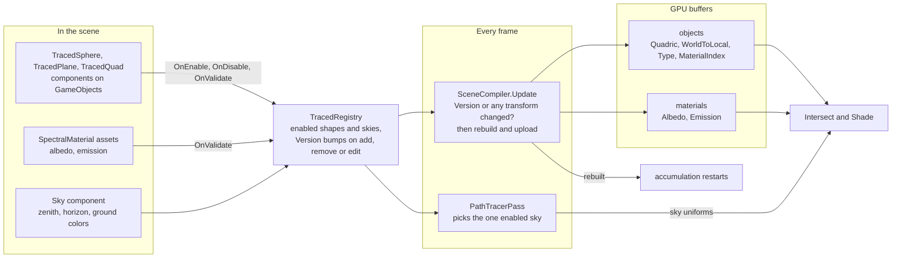

# Scene system

Traced objects are components on ordinary GameObjects. They never render through Unity's meshes. Instead they register
themselves, and once per frame `SceneCompiler` turns them into flat GPU buffers that Intersect and Shade read.

| Piece | Role |
|---|---|
| `TracedShape` | Base component. Registers itself, holds the material, and answers `WorldQuadric` and `WorldToShape`, so the compiler never checks shape types. |
| `TracedQuadric` | Spheres and planes. Turns a local $Q$ into world space with $M^{-\top} Q M^{-1}$. |
| `TracedQuad` | Divides by its `Size` after `worldToLocal`, so the GPU always tests the unit square. |
| `TracedRegistry` | Static, data only. Moving a transform doesn't bump `Version`, which is why the compiler also compares matrices. |
| `SceneCompiler` | Rebuilds only when something changed, deduplicates materials into one table, and grows its buffers by doubling. |

Emission is front-face only, and a sky with black colors turns the open Cornell box into the classic closed look.
