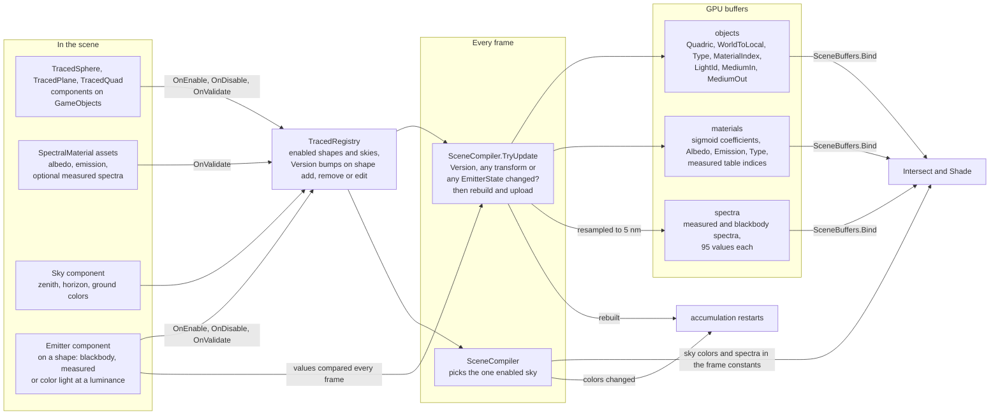

# Scene system

Traced objects are components on ordinary GameObjects. They never render through Unity's meshes. Instead they register
themselves, and once per frame `SceneCompiler` turns them into flat GPU buffers that Intersect and Shade read.

| Piece | Role |
|---|---|
| `TracedShape` | Base component. Registers itself, holds the material, and answers `WorldQuadric` and `WorldToShape`, so the compiler never checks shape types. |
| `TracedQuadric` | Spheres and planes. Turns a local $Q$ into world space with $M^{-\top} Q M^{-1}$. |
| `TracedQuad` | Divides by its `Size` after `worldToLocal`, so the GPU always tests the unit square. |
| `Emitter` | Replaces its shape's material emission with a blackbody at a temperature, a measured spectrum or a color, all at luminance $Y$ = Strength. A component, so Timeline can animate it. |
| `EmitterState` | Every value an emitter's light depends on, as an equatable struct. Timeline writes fields without `OnValidate`, so the compiler compares these every frame, like transforms. |
| `TracedRegistry` | Static, data only. Moving a transform doesn't bump `Version`, which is why the compiler also compares matrices. |
| `SceneCompiler` | Rebuilds only when something changed, deduplicates materials into one table (a shape with an emitter gets its own entry), and picks the sky, comparing its colors every frame since a color edit bumps no version. Every color also becomes sigmoid coefficients through `SigmoidTable`, and measured spectra are resampled into the spectrum buffer. |
| `GrowableBuffer<T>` | A persistent structured buffer that doubles its capacity when an upload outgrows it. |
| `SceneBuffers` | The tables imported for one frame. `Declare` adds the reads to a pass and `Bind` sets every table that `SceneData.hlsl` declares. |
| `GpuData/` | The GPU records. `LightId` and the medium ids are -1 until the light table and media arrive; a material's table indices are -1 unless it has a measured spectrum. |

Emission is front-face only, and a sky with black colors turns the open Cornell box into the classic closed look.
