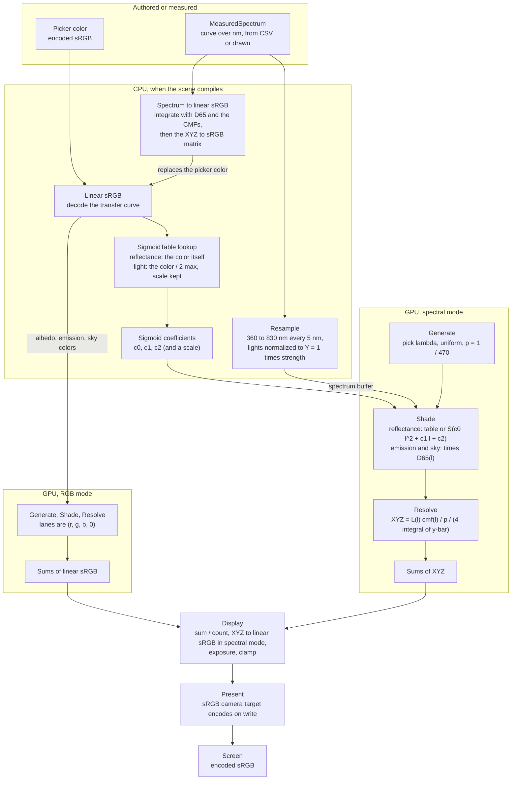

# Color pipeline

Every color in the renderer starts as something an artist picked or a lab measured and ends as a pixel on an sRGB
screen. In between it passes through a few color spaces, and each step between them is one fixed transformation.
RGB mode carries three numbers per path. Spectral mode carries radiance at sampled wavelengths and turns it into color
only at the end, through CIE XYZ.

## The color spaces

| Space | What a value means | Linear in light? | Where it lives |
|---|---|---|---|
| Spectrum $L(\lambda)$ | radiance (or reflectance) at each wavelength, 360 to 830 nm | yes | paths in spectral mode, `MeasuredSpectrum`, sigmoid coefficients |
| CIE XYZ | how strongly the light drives the three CIE matching functions; $Y$ is luminance | yes | the accumulation sums in spectral mode |
| Linear sRGB | amounts of the sRGB screen's red, green and blue primaries; white is D65 | yes | material colors on the GPU, the sums in RGB mode, Display's output |
| Encoded sRGB | linear sRGB through the sRGB transfer curve, for 8-bit storage and screens | no | the color picker, PNGs, the camera target |
| CIELAB | XYZ relative to the D65 white, through cube roots; distance is visible difference | no | only the offline fit, to measure error |

D65 shows up twice: as a light (the spectrum of white light in spectral mode) and as a white point (the color sRGB
maps to (1, 1, 1) and CIELAB measures against).

## From authoring to the screen

Offline, before any of this runs, `SigmoidTableBuilder` fits a sigmoid spectrum to every point of a 64^3 grid of
colors, measuring the error in CIELAB under D65, and `CieShaderTables` writes the matching functions and D65 into an
HLSL include. Both read the C# tables in `Cie`, so the CPU and the GPU use the same numbers.

## The transformations

| Step | Formula | Code |
|---|---|---|
| Decode encoded sRGB | $c \le 0.04045:\ c/12.92$, else $\left(\frac{c + 0.055}{1.055}\right)^{2.4}$ | `Color.linear` in `SceneCompiler` |
| Spectrum to XYZ | $\mathrm{XYZ} = \int L(\lambda)\,\big(\bar x, \bar y, \bar z\big)(\lambda)\,d\lambda \,/\, \int \bar y\,d\lambda$ | `Cie.MatchingFunctions`, `MatchingFunctions` in `Cie.hlsl` |
| One sample's XYZ | $\frac{1}{4}\sum_i L(\lambda_i)\,\bar{\mathbf x}(\lambda_i)/p(\lambda_i) \,/\, \int \bar y$ | `SpectrumToColor` in `SampledSpectrum.hlsl` |
| XYZ to linear sRGB | the 3x3 matrix from sRGB's primaries and D65 | `Cie.XyzToLinearSrgb`, `XYZ_TO_SRGB` |
| Linear sRGB to XYZ | that matrix's inverse | `Cie.LinearSrgbToXyz` |
| Encode for the screen | the inverse of the decode, done by the GPU on write | the sRGB camera target |
| Reflectance under D65 | $\mathrm{XYZ} = \int s\, D65\, \bar{\mathbf x}\, d\lambda \,/\, \int D65\, \bar y\, d\lambda$ | `MeasuredSpectrum.ReflectanceRgb`, `SigmoidFit` |
| Sigmoid spectrum | $s(\lambda) = \frac{1}{2} + \frac{x}{2\sqrt{1 + x^2}},\ x = c_0\lambda^2 + c_1\lambda + c_2$ | `EvaluateSigmoid`, `SigmoidSpectrum.Evaluate` |
| Color to coefficients | trilinear lookup by largest channel, its value and the two ratios | `SigmoidTable.Lookup` |
| Light shape | coefficients of $\text{rgb} / 2\max$, times the scale $2\max$, times $D65(\lambda) \cdot \texttt{CIE\_D65\_SCALE}$ | `SigmoidTable.Unbounded`, `EmissionSpectrum` |
| XYZ to CIELAB | $L^* = 116 f(Y/Y_w) - 16$, $a^* = 500\,(f(X/X_w) - f(Y/Y_w))$, $b^* = 200\,(f(Y/Y_w) - f(Z/Z_w))$, $f$ a cube root | `SigmoidFit.Lab` |

## Things that must stay true

- White stays white. A white wall is a flat reflectance of 1, a white light is D65 at $Y = 1$, and the two together
  come out sRGB (1, 1, 1). The furnaces check this in both modes.
- The sums in spectral mode are XYZ and stay signed in sRGB terms: a single wavelength is outside the sRGB gamut, so
  only the average over many samples is a displayable color. Only Display clamps.
- In split screen both paths above run every wave: the RGB sums go to the first buffer, the XYZ sums to the second, and
  Display converts only the spectral side.
- AOVs are data, not light. Resolve accumulates them as they are, and Display skips the XYZ conversion for them.
- `Cie` (C#) is the single source of the CIE data. Regenerate `CieTables.hlsl` with Tools > Spectral Path Tracer >
  Generate CIE Shader Table after changing it, and rebuild the sigmoid table with Build Sigmoid Table after changing
  the fit.

The checkpoint devlogs cp-25 and cp-26 in `Docs/Checkpoints` explain the math step by step.
