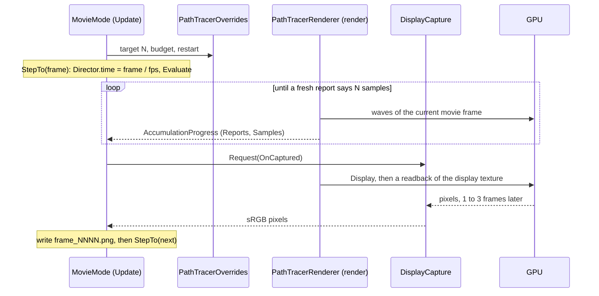

# Tools

Debugging and filming tools, in their own assemblies so the core runtime never depends on the Input System or on any
tool. They talk to the renderer only through static hooks in the runtime: `AccumulationProgress` to read how far
accumulation has got, `PathTracerOverrides` to override the target, the budget or ask for a restart, and
`DisplayCapture` to read back a displayed frame.

- `FlyCamera` flies the camera in Play Mode (WASD, Q and E, look while Space or the right mouse button is held).
- The "Follow Scene View" overlay makes the Main Camera copy the Scene view in Edit Mode.
- `MovieMode` renders a Timeline frame by frame, each to a fixed sample count, and saves PNGs.

## Movie mode

1. Animate the scene with a Timeline on a PlayableDirector, with Play On Awake off. Keyframes recorded in the Timeline
   window work as they are. A clip built by hand that moves the Animator's own transform is root motion and does
   nothing, so bind such a clip to a parent of the camera instead.
2. Add `MovieMode` (disabled) and set its Director, Frame Rate, Samples Per Frame and Frame Budget (ms). Turn off
   `FlyCamera` so it doesn't fight the Timeline.
3. Enter Play Mode and enable `MovieMode`. Frames go to `Recordings/<timeline name>/frame_0000.png` at the project root
   (ignored by git), and the component disables itself after the last one. Unity can be in the background.
4. Make a video: `ffmpeg -framerate 30 -i frame_%04d.png -c:v libx264 -pix_fmt yuv420p -crf 12 movie.mp4`.

Only transforms and the camera are noticed between frames today. An animated field on a component doesn't fire
`OnValidate`, so the scene isn't rebuilt for it, and ScriptableObject fields can't be keyframed.

Stepping only from the capture callback matters. A step in the same `Update` as the request would restart
accumulation in the very frame the readback copies, and the file would hold the next frame's first samples.
