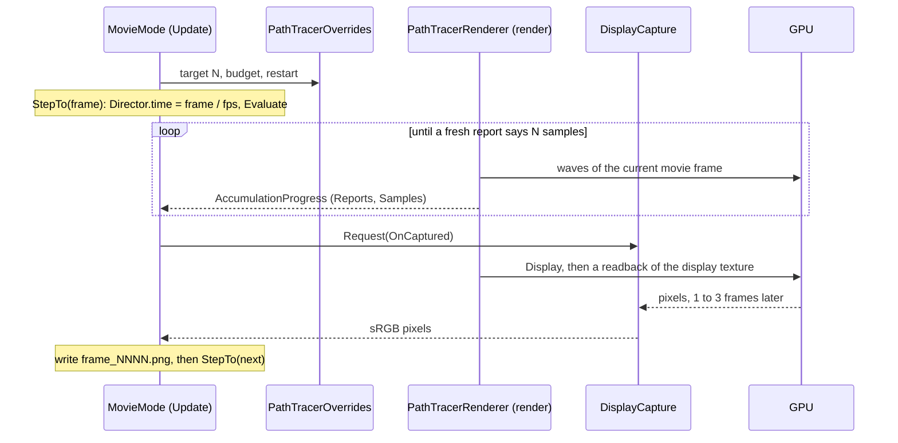

# Tools

Debugging and filming tools, in their own assemblies so the core runtime never depends on the Input System or on any
tool. They talk to the renderer only through static hooks in the runtime: `AccumulationProgress` to read how far
accumulation has got, `PathTracerOverrides` to override the target, the budget or ask for a restart,
`DisplayCapture` to read back a displayed frame, and `AccumulationCapture` to read back each pixel's mean radiance.

- `FlyCamera` flies the camera in Play Mode (WASD, Q and E, look while Space or the right mouse button is held).
- The "Follow Scene View" overlay makes the Main Camera copy the Scene view in Edit Mode.
- `MovieMode` renders a Timeline frame by frame, each to a fixed sample count, and saves PNGs.
- Tools > Spectral Path Tracer > Furnace Check reads the accumulated radiance back as floats and judges it against
  the scene's `FurnaceExpectation`.
- Tools > Spectral Path Tracer > Spectrum Check proves the CIE tables, the XYZ to sRGB matrix and the $1/p$ of
  wavelength sampling against known values.

## Movie mode

1. Animate the scene with a Timeline on a PlayableDirector, with Play On Awake off. Keyframes recorded in the Timeline
   window work as they are. A clip built by hand that moves the Animator's own transform is root motion and does
   nothing, so bind such a clip to a parent of the camera instead.
2. Add `MovieMode` (disabled) and set its Director, Frame Rate, Samples Per Frame and Frame Budget (ms). Turn off
   `FlyCamera` so it doesn't fight the Timeline.
3. Enter Play Mode and enable `MovieMode`. Frames go to `Recordings/<timeline name>/frame_0000.png` at the project root
   (ignored by git), and the component disables itself after the last one. Unity can be in the background.
4. Make a video: `ffmpeg -framerate 30 -i frame_%04d.png -c:v libx264 -pix_fmt yuv420p -crf 12 movie.mp4`.

Only transforms and the camera are noticed between frames today. An animated field on a component doesn't fire
`OnValidate`, so the scene isn't rebuilt for it, and ScriptableObject fields can't be keyframed.

Stepping only from the capture callback matters. A step in the same `Update` as the request would restart
accumulation in the very frame the readback copies, and the file would hold the next frame's first samples.

## Furnace check

The furnaces are scenes with an answer known from the math, in `Scenes/Furnaces/`. Open one with the Game view
visible, let it render, and run Tools > Spectral Path Tracer > Furnace Check. It logs PASS, or an error on FAIL, with
the mean, min and max radiance and the sample counts. Run both after every checkpoint that touches light transport.

| Scene | Setup | Expected | Judged on |
|---|---|---|---|
| `Furnace` | albedo 1 sphere in a uniform sky of 1 | exactly 1 | every pixel, tolerance $10^{-4}$ |
| `FurnacePlanes` | two facing planes, emission 1, linear albedo 0.5, black sky | $2 - 2^{-16} = 1.99998$ at 16 bounces | the mean, tolerance $2 \times 10^{-3}$ |

The sphere has no noise at all (every sample is exactly 1), so a single sample is enough and any deviation is a bug.
It can't see where samples go, only what they weigh, and its paths never reach Russian roulette; the planes cover
multiple bounces and roulette. Picker colors are sRGB and get converted to linear, so a linear albedo of 0.5 is
0.735357 in the picker.

## Spectrum check

Seven lines, each PASS or an error on FAIL. It needs no scene.

| Check | Expected | Catches |
|---|---|---|
| Sum of $\bar y$ at 1 nm | 106.857 | a wrong or shifted table |
| Flat light's chromaticity $x$, $y$ | $1/3$, $1/3$ | unequal curve areas |
| D65 at $Y = 1$ through the matrix | sRGB (1, 1, 1) | a wrong or transposed matrix |
| Flat $Y$ from 65,536 uniform wavelengths, over the $\bar y$ integral | 1, within 0.02 | a missing $1/p$ (it would read about 0.002) |
